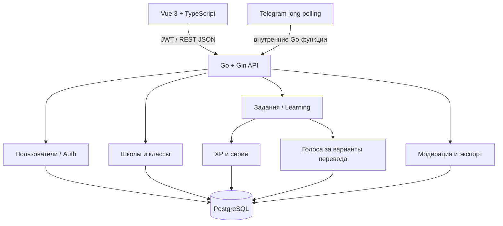

# Архитектура расширенного MVP

## Поток данных

## Границы модулей

- `auth.go`, `admin.go`: пользователи, JWT, роли, одноразовый код привязки Telegram.
- `learning.go`: выдача закреплённого задания, сохранение ответа, начисление XP, консенсус.
- `other.go`: запросы контента, рейтинги, история данных и экспорт.
- `education.go`: школы, классы, участники, отчёты.
- `moderation.go`: утверждение и управление спорными переводами.
- `bot.go`: внешний Telegram-интерфейс с FSM и сохранением состояния.

Это **файловое логическое разделение одного Go-пакета `main`**, а не отдельные независимо компилируемые Go-модули. Следующий архитектурный шаг — выделить `internal/{auth,learning,translation,education}` с интерфейсами сервисов и репозиториев. Для MVP единый бинарник упрощает развёртывание и ускоряет интеграцию.

## Согласование переводов

- Исходный кандидат добавляется модератором или берётся из демонстрационной базы.
- Предложенный вариант показывается ученику без информации о правильности.
- Ответ всегда сохраняется в `answers`; корректировка регистрируется как отдельный вариант в `candidates`.
- Считается число **уникальных пользователей** с ответами по конкретному фрагменту и языковой паре.
- После 5 ответивших, при поддержке одного кандидата не менее чем 80% ответивших, запись появляется в `translations` со статусом `confirmed`.
- Иначе создаётся `moderation_cases` со статусом `open`.
- Обработка синонимов автоматически **пока отсутствует**: вариант должен совпадать в точности, либо эксперт утверждает спорный вариант.

Важно: механизм консенсуса не гарантирует качество без проверки профессиональными носителями языка; для публикации ответственных корпусов требуется экспертная оценка.

## Транзакционная целостность

- Ответ, XP и обновление `tasks` происходят в одной SQL-транзакции.
- Уникальные ограничения для `(task_id)` и `(idempotency_key)` исключают повторную отправку.
- `xp_events` защищён уникальным ограничением `(user_id, reason, source_id)`.
- Для высокой нагрузки вынести проверку консенсуса в отдельную outbox-задачу.

## Доступы

| Роль | Права |
|---|---|
| `student` | Профиль, задания, история, рейтинги, библиотека, экспорт |
| `teacher` | Права ученика, создание классов, ученики и отчёты своих классов |
| `moderator` | Права ученика, материалы, фрагменты, спорные переводы |
| `admin` | Все функции, назначение ролей, управление классами |

Авторизация на JWT; сервер проверяет права для защищённых маршрутов. В существующем MVP нет механизма восстановления пароля, подтверждения почты и отдельного аудита. Не использовать в публичной эксплуатации без hardening.

## Связь с ТЗ

| Требование ТЗ | MVP |
|---|---|
| Веб-сайт | Vue 3 + TypeScript |
| Telegram FSM, `/start` и `/cancel` | Go, PostgreSQL |
| Языковые пары | `ba-ru` в MVP, структура позволяет расширить |
| Текстовые фрагменты и координаты | PostgreSQL |
| Аудио/TTS | тип материала предусмотрен; полноценная обработка не реализована |
| Ежедневные задания | Да |
| Подмешивание ошибок | Демонстрационные заранее подготовленные ошибочные варианты |
| Консенсус | Да, точное совпадение и 5/80% |
| Синонимы и экспертное согласование | Ручная модерация; полноценная семантика не реализована |
| XP, уровни, серия, достижения | Да |
| Рейтинг школ и классов | Да |
| Выгрузка JSON/CSV со структурой | Да |
| Учёт прав на исходные материалы | Поле `license`, ручная проверка контента |

## Расширяемые языковые пары

`language_pairs` — справочник языковых направлений. Код формируется как `<source_lang>-<target_lang>` (двух- или трёхбуквенные коды), например `ba-en` или `ru-ba`. Для новых направлений создаются варианты `candidates` с `lang_pair`, которые связаны с `fragments.source_lang` через направление. `tasks`, `answers`, `moderation_cases`, `translations` продолжают сохраняться раздельно по направлению.

Фрагменты содержат исходный текст в унаследованной колонке `text_ba`; для нового контента язык определяется полем `source_lang`, поэтому имя старой колонки — историческое. При переходе на полностью языково-нейтральную БД её следует переименовать в `source_text` отдельной совместимой миграцией. Для экспорта по ТЗ поле `text_ba` сохраняется.

Админские маршруты `GET /admin/language-pairs`, `POST /admin/language-pairs`, `PATCH /admin/language-pairs/:code`; публичный `GET /language-pairs` возвращает только активные пары. При отсутствии исходных фрагментов/переводов новая пара не создаёт фиктивные задания.
